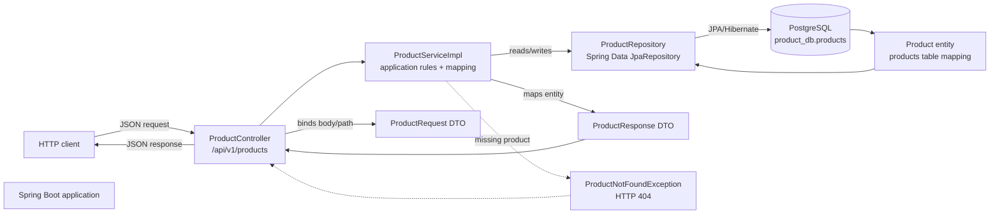
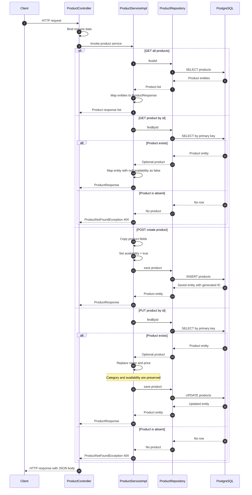

# Spring REST API

A Spring Boot REST API for creating, reading, and updating products. The application uses Spring Web MVC, Spring Data JPA, and PostgreSQL.

## Architecture

The request path follows a layered design. Controllers expose HTTP endpoints, services apply application rules and map data, repositories delegate persistence to Spring Data JPA, and PostgreSQL stores the `products` table.



### Responsibilities

| Layer | Implementation | Responsibility |
| --- | --- | --- |
| HTTP/API | `ProductController` | Routes requests and binds JSON, path variables, and responses |
| Application | `ProductServiceImpl` | Applies create/update rules, handles missing IDs, and maps entities to response DTOs |
| Persistence | `ProductRepository` | Uses Spring Data JPA for `findAll`, `findById`, and `save` |
| Data model | `Product` | Maps to the PostgreSQL `products` table |
| API DTOs | `ProductRequest`, `ProductResponse` | Separates request/response payloads from the persistence model |
| Database | PostgreSQL `product_db` | Stores product records; Hibernate uses `ddl-auto=update` |

## Execution flow

The following sequence shows the common request lifecycle and the service behavior for each supported operation.



## Endpoints

| Method | Path | Behavior |
| --- | --- | --- |
| `GET` | `/api/v1/products` | Returns all products; an empty database returns `[]` |
| `GET` | `/api/v1/products/{id}` | Returns one product by database ID |
| `POST` | `/api/v1/products` | Creates a product and sets `available` to `true` |
| `PUT` | `/api/v1/products/id/{id}` | Updates only `name` and `price` |

| `GET` | `/api/v1/products/search/derived?category=Electronics` | Searches category using a derived query |
| `GET` | `/api/v1/products/search/jpql?category=Electronics` | Searches category using JPQL |
| `GET` | `/api/v1/products/search/native?name=Keyboard` | Searches name across categories using native SQL |
| `GET` | `/api/v1/products/search/category-and-name?category=Electronics&name=Keyboard` | Requires both category and name to match |

The PUT route intentionally includes the `/id/` segment. A nonnumeric ID normally results in HTTP 400 during path-variable conversion; a missing numeric ID results in HTTP 404.

## Configuration

The application connects to PostgreSQL at `localhost:5432/product_db` as user `postgres`. Set the password before starting the application:

```shell
# PowerShell
$env:DB_PASSWORD = "your-postgres-password"
./mvnw spring-boot:run
```

The request price must be non-null because `ProductRequest.price` is a nullable `Double` and the entity stores a primitive `double`. POST validates the name with `@NotBlank` and `@Size(min = 3, max = 10)`. PUT does not activate request-body validation; category and price have no Bean Validation constraints.

## Tests

Run the search integration tests, service unit tests, or full suite:

```shell
mvn -Dtest=ProductSearchTests test
mvn -Dtest=ProductServiceImplTests test
mvn test
```

You can replace `mvn` with `.\mvnw.cmd` on Windows. Integration and context-loading tests use the isolated H2 database in PostgreSQL compatibility mode configured in `src/test/resources/application.properties`; they do not require a running PostgreSQL server. Service unit tests use a mocked repository.

### Search test scenarios

`ProductSearchTests` seeds three products before each test: Keyboard/Electronics (null availability), Mouse/Electronics (available), and Keyboard/Office (unavailable), each priced at 49.5. Changes are rolled back after each test. All paths below start with `/api/v1/products/search`.

| Scenario | GET request | Expected result |
| --- | --- | --- |
| Derived category lookup | `/derived?category=Electronics` | 200; Keyboard and Mouse; null availability maps to false |
| JPQL category lookup | `/jpql?category=Electronics` | 200; Keyboard and Mouse; numeric ID and price 49.5 |
| Native name lookup across categories | `/native?name=Keyboard` | 200; both Keyboards from Electronics and Office |
| Combined category and name | `/category-and-name?category=Electronics&name=Keyboard` | 200; only the Electronics Keyboard |
| No matching products, all four routes | Supply `category=Missing&name=Missing` | 200 with `[]` |
| Missing required parameters, all four routes | Call each route without query parameters | 400 |
| Category alone on native search | `/native?category=Electronics` | 400 because `name` is required |
| Missing name on combined search | `/category-and-name?category=Electronics` | 400 |

The native search uses `gerProductName` and SQL equality on `name`; it does not filter by category. Search ordering is unspecified. The scenarios above are covered by 12 test invocations, with multiple assertions in some tests.

### Other automated coverage

- `ProductServiceImplTests`: maps all lookup response fields, converts null availability to false, and throws `ProductNotFoundException` for a missing ID. These tests do not verify HTTP status mapping.
- `SpringRestApiApplicationTests`: verifies that the application context starts with H2.

Latest search verification: `mvn -Dtest=ProductSearchTests test` passed all 12 tests with no failures or errors. This verifies MockMvc routing, response mapping, and real queries against H2, not a live PostgreSQL server. The full suite was not rerun for this documentation update.

See [Product API notes](PRODUCT_API_NOTES.md) for request examples and implementation details.
