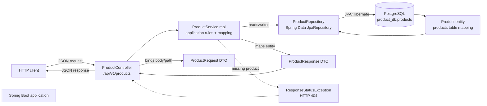

# Spring REST API

A Spring Boot REST API for creating, reading, and updating products. The application uses Spring Web MVC, Spring Data JPA, and PostgreSQL.

## Architecture

The request path follows a layered design. Controllers expose HTTP endpoints, services apply application rules and map data, repositories delegate persistence to Spring Data JPA, and PostgreSQL stores the `products` table.



### Responsibilities

| Layer | Implementation | Responsibility |
| --- | --- | --- |
| HTTP/API | `ProductController` | Routes requests and binds JSON, path variables, and responses |
| Application | `ProductServiceImpl` | Applies create/update rules, handles missing IDs, and maps entities to response DTOs |
| Persistence | `ProductRepository` | Uses Spring Data JPA for `findAll`, `findById`, and `save` |
| Data model | `Product` | Maps to the PostgreSQL `products` table |
| API DTOs | `ProductRequest`, `ProductResponse` | Separates request/response payloads from the persistence model |
| Database | PostgreSQL `product_db` | Stores product records; Hibernate uses `ddl-auto=update` |

## Execution flow

The following sequence shows the common request lifecycle and the service behavior for each supported operation.

```mermaid
sequenceDiagram
    autonumber
    participant C as Client
    participant PC as ProductController
    participant PS as ProductServiceImpl
    participant PR as ProductRepository
    participant DB as PostgreSQL

    C->>PC: HTTP request
    PC->>PC: Bind path variables/request JSON
    PC->>PS: Invoke product service

    alt GET /api/v1/products
        PS->>PR: findAll()
        PR->>DB: SELECT products
        DB-->>PR: Product entities
        PR-->>PS: List<Product>
        PS->>PS: Map entities to ProductResponse
        PS-->>PC: List<ProductResponse>
    else GET /api/v1/products/{id}
        PS->>PR: findById(id)
        PR->>DB: SELECT by primary key
        alt Product exists
            DB-->>PR: Product entity
            PR-->>PS: Optional<Product>
            PS->>PS: Map entity; null availability becomes false
            PS-->>PC: ProductResponse
        else Product is absent
            DB-->>PR: No row
            PR-->>PS: Optional.empty()
            PS-->>PC: ResponseStatusException (404)
        end
    else POST /api/v1/products
        PS->>PS: Copy name/category/price
        PS->>PS: Set availability = true
        PS->>PR: save(Product)
        PR->>DB: INSERT products
        DB-->>PR: Saved entity with generated ID
        PR-->>PS: Product entity
        PS-->>PC: ProductResponse
    else PUT /api/v1/products/id/{id}
        PS->>PR: findById(id)
        PR->>DB: SELECT by primary key
        alt Product exists
            DB-->>PR: Product entity
            PR-->>PS: Optional<Product>
            PS->>PS: Replace name and price
            Note over PS: Category and availability are preserved
            PS->>PR: save(Product)
            PR->>DB: UPDATE products
            DB-->>PR: Updated entity
            PR-->>PS: Product entity
            PS-->>PC: ProductResponse
        else Product is absent
            DB-->>PR: No row
            PR-->>PS: Optional.empty()
            PS-->>PC: ResponseStatusException (404)
        end
    end

    PC-->>C: HTTP response with JSON body
```

## Endpoints

| Method | Path | Behavior |
| --- | --- | --- |
| `GET` | `/api/v1/products` | Returns all products; an empty database returns `[]` |
| `GET` | `/api/v1/products/{id}` | Returns one product by database ID |
| `POST` | `/api/v1/products` | Creates a product and sets `available` to `true` |
| `PUT` | `/api/v1/products/id/{id}` | Updates only `name` and `price` |

The PUT route intentionally includes the `/id/` segment. A nonnumeric ID normally results in HTTP 400 during path-variable conversion; a missing numeric ID results in HTTP 404.

## Configuration

The application connects to PostgreSQL at `localhost:5432/product_db` as user `postgres`. Set the password before starting the application:

```shell
# PowerShell
$env:DB_PASSWORD = "your-postgres-password"
./mvnw spring-boot:run
```

The request price must be non-null because `ProductRequest.price` is a nullable `Double` and the entity stores a primitive `double`. Bean Validation constraints are not currently configured.

## Tests

Run the service unit tests with:

```shell
./mvnw -Dtest=ProductServiceImplTests test
```

The context-loading test requires access to the configured PostgreSQL database.
